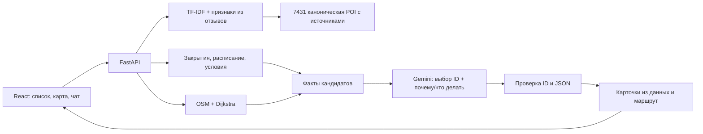

# Демонстрация Smart City

## Проблема и пользователи

Жителю или гостю Астаны нужно выбрать занятие в пределах ограниченного времени. Каталог показывает много мест, но сам по себе не проверяет, успеет ли человек дойти и посетить место. Astana Walk объединяет запрос, источники, расписание и пешеходный граф.

## Архитектура



## Проверяемые сценарии

1. **30–60 минут возле MEGA Silk Way.** Выберите MEGA в начале маршрута, 60 минут, запрос «прогулка». Ожидание: доступные по графу места, время пути + оценка посещения <=60 минут. Не найденный путь не заменяется прямой линией.
2. **Тихое кафе с розеткой.** Запрос «кафе с розеткой и тихой обстановкой». Без строгого фильтра неизвестные свойства явно отмечены. Со строгим фильтром показываются только места с обоими подтверждениями либо честный пустой результат.
3. **Прогулка с ребёнком.** Запрос «куда сходить с ребёнком», 90–120 минут. Ожидание: детские/культурные/развлекательные категории, реальные названия, цены и возрастные ограничения только если есть данные. Категория сама по себе не доказывает пригодность для конкретного возраста.
4. **Туристу два часа.** Начало у Бәйтерек, 120 минут. Выберите до трёх мест, сравните, соберите маршрут. Ожидание: последовательный план в бюджете без обратной дороги; исключённые остановки объяснены.
5. **Вечер.** Укажите дату и время вечером, включите фильтр расписания. Ожидание: неизвестные часы не выданы за подтверждение открытия. Результат может оказаться пустым.
6. **Сбой LLM.** Уберите `GEMINI_API_KEY` или исчерпайте квоту. Ожидание: предупреждение с причиной (нет ключа, HTTP 429) и локальный поиск, без выдуманных карточек. «Почему» и «что делать» остаются: они собраны по шаблону из данных места (время пути, подтверждённые удобства, рейтинг, расписание) на языке запроса и помечены «Из данных».
6a. **Мини-маршрут.** В чате: «Хочу прогуляться 3 часа у Байтерека». Ожидание: 2–3 разных места в порядке обхода, у каждого «через N мин · M мин пути · K мин на месте», общее время не больше бюджета, линия маршрута на карте.
6b. **Событие в месте назначения.** «Условия прогулки» → время 24.10 15:30, старт Бәйтерек, в чате: «Идём в Столичный цирк». Ожидание: старт не меняется, в ответе только цирк с маршрутом от Байтерека, блок «События во время прогулки» с шоу в 16:00 и честная фраза «пешком к началу не успеть: путь ~37 мин». Со стартом рядом с цирком (точка на карте) пометки нет. Анонс помечен как неподтверждённый.
6c. **Компания.** «Нас 5, хотим поужинать возле Байтерека». Ожидание: «Подбор для компании из 5 человек», выше рестораны с VIP-залом / кабинками, бюджет «На 5 чел. ≈ …», совет забронировать стол.
6d. **Пример из PDF.** «Я у здании Экспо 2017, хочу что-то необычное на 1–2 часа, пешком.» Ожидание: старт EXPO 2017 (из текста), бюджет 120 мин (верхняя граница диапазона), культурные места и развлечения в 3–18 мин пешком, «Территория EXPO» как место, где пользователь уже стоит, не предлагается. Блок «Учтено» показывает старт, время и категории.
6e. **Музей и кофе.** «Маршрут на 2 часа от Байтерека: музей и кофе». Ожидание: мини-маршрут, в котором есть и музей, и кафе; в «Учтено» — «Ищу вместе: кафе + музей».
7. **Неподходящий старт.** Точка вдали от графа. Ожидание: отсутствие фиктивного маршрута и предложение сменить точку.
8. **Два часа до вылета.** «Я турист, у меня 2 часа перед вылетом, что посмотреть поблизости?» Без своих значений чат явно принимает 30 мин дороги + 60 мин в аэропорту, говорит об этом и предлагает места на оставшиеся 30 мин. В «Условия прогулки → Если скоро вылет» можно указать свои оценки; при недостатке времени прогулка не предлагается. Пробки и требования авиакомпании автоматически не определяются.
9. **Океанариум Думан.** Выберите начало Ailand и найдите океанариум. Покажите отдельную карточку, билеты «Стандарт» 5 600 ₸ / детский 4 400 ₸ и ссылки оператора. Возрастные границы не придуманы, тариф не переносится на весь комплекс.
10. **Проверка афиши.** Откройте «Афиша», нажмите проверку источника. При недоступности страницы интерфейс показывает неудачную проверку, а не подтверждённое проведение.

Исторические снимки можно демонстрировать с датой 2026-10-19 и началом в 12:00 UTC+5. Не представляйте их как данные текущего открытия.

## Перед выступлением

- Запустите приложение заранее: `docker compose up -d --build`, дождитесь `healthy` в `docker compose ps`.

- Проверьте доступ к Gemini API из сети площадки. Некоторые сети сбрасывают соединение с `generativelanguage.googleapis.com`, хотя `google.com` открывается:

  ```bash
  curl -sS -o /dev/null -w "%{http_code}\n" https://generativelanguage.googleapis.com/v1beta/models
  ```

  `403` — доступ есть (запрос без ключа). `Connection was reset` — домен блокируется. Держите запасной канал: раздачу с телефона.
- Ключ должен быть на платном тарифе (Tier 1): на бесплатном около 20 запросов в сутки на модель.
- Без доступа к модели чат честно показывает причину и отвечает локальным поиском. Признаки из отзывов уже лежат в `data/review_signals.jsonl` и работают без сети, а подложке карты интернет нужен.

## Порядок выступления на 5–7 минут

- 0:00–0:45: проблема и аудитория.
- 0:45–2:30: прогулка возле MEGA, карта, карточка и источник.
- 2:30–3:30: запрос про тихое кафе; показать различие неизвестного и подтверждённого.
- 3:30–4:30: сравнение и маршрут из нескольких остановок.
- 4:30–5:30: архитектура RAG, модель выбирает только ID из контекста, факты формирует backend.
- 5:30–6:30: ограничения, приватность, план улучшений.

## Соответствие PDF и то, что команде остаётся подготовить

Данные нормализованы, атрибуты индексируются, маршруты строятся на лету, погода запрашивается у Open-Meteo. Есть интерактивный прототип, собственный собранный датасет, описание RAG, тестовые сценарии и заметки об ограничениях/приватности. Команде нужно подготовить финальные слайды, записать YouTube-демо и опубликовать репозиторий/ссылку на прототип согласно правилам организаторов. Сам архив не заменяет эти материалы.

Следующие улучшения: подтверждённые входы, более полные правила/тарифы, регулярное обновление закрытий, независимое подтверждение мероприятий, качественный казахский диалог с контекстом, фактическая оценка релевантности на размеченных запросах. Погодный запрос уже подключён; это модельная оценка для центра города.

## Приватность и безопасное использование

Нет базы пользователей, истории координат или постоянного хранения чатов. Геолокация запрашивается только по кнопке; API получает координаты для расчёта. Локальный сервер запускается без access-log. Внешняя подложка OSM видит IP/запросы тайлов, Google Fonts — запрос шрифта. Gemini видит текст запроса и контекст карточек (на бесплатном тарифе Google может использовать запросы для улучшения продуктов, на платном — нет); свободный текст может содержать написанный пользователем адрес. Перед публичным хостингом нужны ограничения запросов, TLS и политика обработки данных.

Прототип не проверяет криминальную безопасность маршрута, актуальные строительные работы и качество переходов. Учитывайте обстановку на месте.
